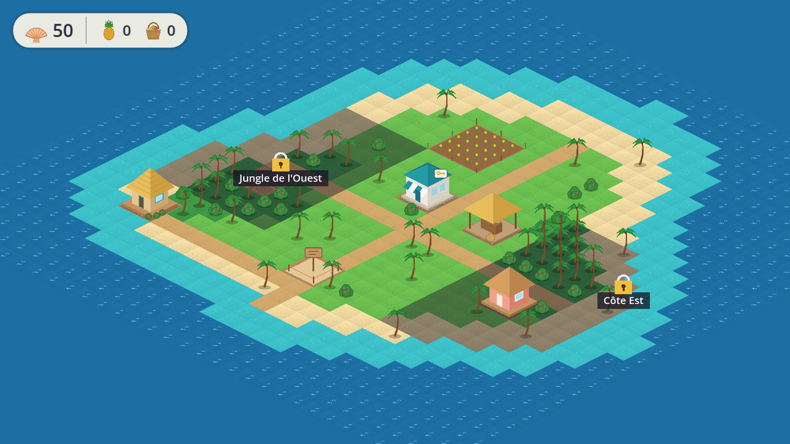
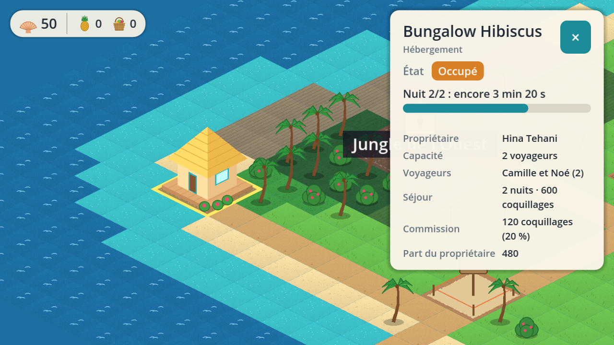

# Island Concierge

Prototype (V0.1) de jeu mobile Android de gestion en 2D isométrique, réalisé
avec **Godot 4.4.1** et GDScript. Le joueur gère une conciergerie touristique
sur l'île de Mahana.

L'architecture et le plan d'implémentation sont décrits dans
[`docs/ARCHITECTURE.md`](docs/ARCHITECTURE.md).

## Prérequis

- [Godot 4.4.1-stable](https://godotengine.org/download/archive/4.4.1-stable/)
  (version figée dans `.godot-version`).

## Lancer le jeu

1. Ouvrir Godot, *Importer* puis choisir `island-concierge/project.godot`.
2. Appuyer sur **F5** (ou ▶).

En ligne de commande : `godot --path island-concierge`

### Contrôles

| Geste | Écran tactile | PC |
|-------|---------------|----|
| Déplacer la carte | glisser un doigt (inertie au lâcher) | cliquer-glisser |
| Zoomer / dézoomer | pincer à deux doigts | molette |
| Sélectionner | tap | clic |

Sur PC, la souris émule un doigt (`emulate_touch_from_mouse`).

## Android

Voir [`docs/ANDROID_EXPORT.md`](docs/ANDROID_EXPORT.md) : export debug depuis l'éditeur ou
`tools/export_android_debug.sh`, installation via `adb`, liste de vérification
sur appareil.

## Lancer les tests

Les tests utilisent [GUT 9.4.0](https://github.com/bitwes/Gut) (licence MIT,
inclus dans `addons/gut/`).

```bash
tools/run_tests.sh                 # depuis island-concierge/, headless
GODOT=/chemin/vers/godot tools/run_tests.sh
```

Le script renvoie un code non nul si un test échoue. Les tests peuvent aussi
être lancés depuis l'éditeur via le panneau **GUT** en bas de l'écran.

## Captures d'écran (Linux, xvfb)

```bash
tools/capture.sh res://scenes/main.tscn capture.png   # une scène
tools/visual_checks.sh captures/                      # scénarios de gestes simulés
```

`tools/visual_checks.gd` rejoue des gestes (pincement, glisser, tap) avec les
mêmes `InputEvent` qu'un écran tactile et enregistre une capture par scénario.
Ce n'est **pas** un test sur appareil : les captures utilisent le renderer
de compatibilité OpenGL.

## Graphismes provisoires

Les tuiles et décors de `assets/tiles/` sont générés par un script (Pillow) :

```bash
python3 tools/generate_placeholder_art.py
```

## Carte de Mahana

Le plan 32×32 est le champ `layout` de `data/maps/mahana.tres` : une ligne
par rangée, un caractère par cellule.

| Caractère | Terrain |
|-----------|---------|
| `~` | océan |
| `-` | lagon |
| `.` | sable |
| `,` | herbe |
| `T` | jungle |
| `#` | chemin |
| `+` | parcelle constructible |

Les zones verrouillées sont des rectangles de cellules (`zones`).





## Économie (V0.1)

- Monnaie : **coquillages** (`data/currencies/shells.tres`). Une autre monnaie
  (ex. perles) s'ajoute par un fichier de données, sans code. Aucun paiement réel.
- Partie neuve : `data/balance/new_game.tres` (50 coquillages, inventaire de 50 places).
- Règles (`src/core/wallet.gd`, `src/core/inventory.gd`) : montants entiers
  positifs, jamais de solde négatif, opérations atomiques, journal des
  mouvements, sauvegarde/restauration avec correction des valeurs invalides.

## Boucle jouable (V0.1, étape 7)

1. Toucher le **bureau de conciergerie** (pastille « ! ») et accepter une réservation.
2. Toucher le **Bungalow Hibiscus** : « Faire le ménage » (2 min).
3. « Accueillir les voyageurs » : le séjour dure nuits × 5 min et se termine seul.
4. « Encaisser » la commission (20 % du prix du séjour).

Les durées sont réglables dans `data/balance/timings.tres` et les fichiers de recettes.

## Organisation

| Dossier        | Rôle |
|----------------|------|
| `src/core/`    | règles métier pures (sans scène), entièrement testées |
| `src/defs/`    | classes décrivant les données de jeu |
| `src/view/`    | logique de présentation pure (caméra, gestes), testée |
| `src/autoload/`| services globaux (`EventBus`, …) |
| `data/`        | données configurables (bâtiments, ressources, carte) |
| `scenes/`      | présentation : carte, caméra, bâtiments, interface |
| `i18n/`        | textes traduisibles (`strings.csv`, colonne par langue) |
| `tests/`       | tests GUT unitaires et d'intégration |
| `tools/`       | scripts de développement |

## Langues

Tous les textes affichés passent par une clé de traduction (`tr("CLE")`).
Pour ajouter l'anglais : ajouter une colonne `en` à `i18n/strings.csv`, puis
déclarer `res://i18n/strings.en.translation` dans
*Projet → Paramètres → Localisation*.
